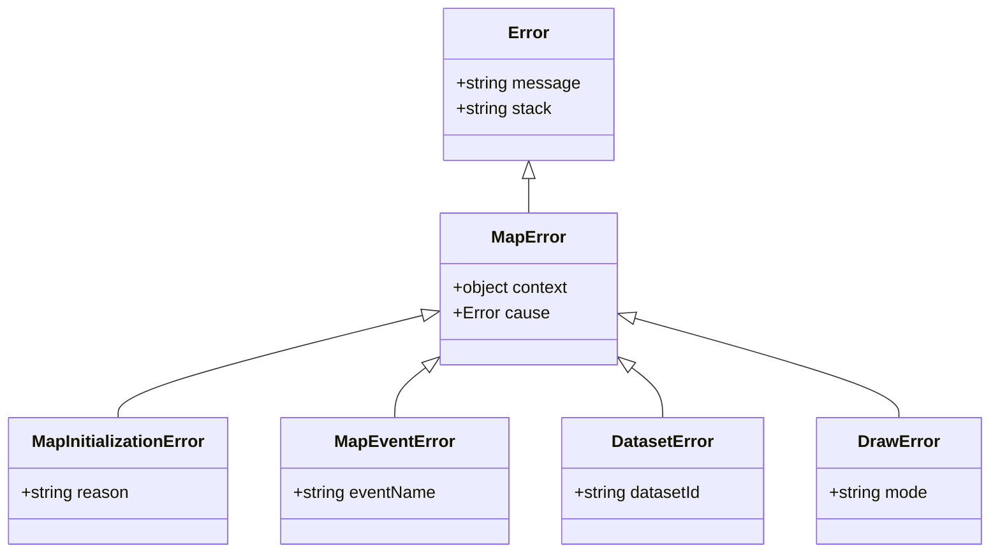

# Gỡ lỗi & Bắt lỗi hệ thống (Debugging & Error Handling)

Hệ thống cung cấp module chuyên biệt `@hungpvq/map-debug` và các lớp lỗi tường minh giúp lập trình viên nhanh chóng xác định nguyên nhân sự cố trong quá trình phát triển.

---

## 1. Hệ thống phân loại lỗi (Error Classes)

Thư viện định nghĩa các lớp lỗi mở rộng từ `Error` chuẩn của JavaScript:



* **`MapInitializationError`**: Xảy ra khi WebGL bị tắt, container element không tồn tại hoặc style spec bị lỗi cú pháp.
* **`MapEventError`**: Xảy ra khi callback sự kiện phát sinh ngoại lệ không mong muốn.
* **`DatasetError`**: Xảy ra khi nạp GeoJSON sai format hoặc URL Vector tile trả về HTTP 404 / 500.
* **`DrawError`**: Xảy ra khi thao tác vẽ hình học không hợp lệ (tự cắt nhau, thiếu đỉnh).

---

## 2. Bắt lỗi toàn cục với `installGlobalErrorCapture`

Để ứng dụng không bị crash trắng trang khi có sự cố WebGL:

```ts
import { installGlobalErrorCapture, errorHandler } from '@hungpvq/map-core';

// Kích hoạt cơ chế bắt lỗi toàn cục
installGlobalErrorCapture();

// Đăng ký nhận thông báo lỗi để hiển thị lên UI hoặc gửi về Sentry/LogRocket
errorHandler.subscribe((err) => {
  console.warn('[Map System Warning]:', err.message);
  if (err.context) {
    console.warn('Ngữ cảnh lỗi:', err.context);
  }
});
```

---

## 3. Sử dụng Devtools Panel (`@hungpvq/vue-map-devtools`)

Thư viện cung cấp component bảng điều khiển Devtools dành riêng cho việc debug trực quan:

```vue
<!-- Vue -->
<template>
  <Map :map-id="mapId">
    <!-- Bảng điều khiển debug nổi góc màn hình -->
    <MapDevtools />
  </Map>
</template>

<script setup lang="ts">
import { Map } from '@hungpvq/vue-map-core';
import { MapDevtools } from '@hungpvq/vue-map-devtools';
</script>
```

Bảng Devtools cung cấp các tab:
1. **Stores**: Xem trạng thái thời gian thực của `MapStoreManager`, danh sách dataset, trạng thái theme.
2. **Logs**: Ghi lại lịch sử sự kiện click, move, render, nạp tile.
3. **Errors**: Danh sách các lỗi và cảnh báo vừa phát sinh.
