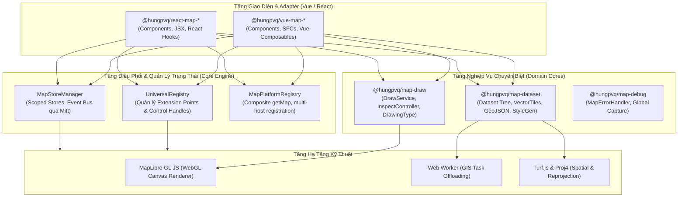

# Kiến trúc hệ thống (Architecture)

## 1. Tổng quan kiến trúc đa tầng (Multi-tier Architecture)

Bộ thư viện `@hungpvq/map-*` được thiết kế theo mô hình phân tầng chặt chẽ. Nguyên tắc quan trọng nhất: **Tầng dưới không phụ thuộc vào tầng trên; tầng lõi không phụ thuộc vào bất kỳ framework giao diện nào.**

---

## 2. Các tầng trong kiến trúc

### 2.1. Tầng Hạ tầng & Thư viện nền tảng (Foundation Layer)
* **MapLibre GL JS**: Động cơ render bản đồ vector/raster dựa trên WebGL. Đảm bảo tốc độ hiển thị 60fps khi pan/zoom, hỗ trợ style spec chuẩn.
* **Turf.js**: Thư viện giải thuật hình học không gian (tính diện tích, khoảng cách, bounding box, centroid...).
* **Proj4**: Chuyển đổi tọa độ giữa các hệ quy chiếu (WGS84 EPSG:4326, Web Mercator EPSG:3857, VN-2000, UTM...).
* **Web Worker**: Tách biệt luồng tính toán nặng ra khỏi Main Thread để giao diện không bị giật lag.

### 2.2. Tầng Nghiệp vụ cốt lõi (Domain Core Layer)
* **`@hungpvq/map-core`**: Chứa toàn bộ logic khởi tạo bản đồ (`MapInitializer`), quản lý instance (`getMap`), lưu trữ trạng thái đa bản đồ, hệ thống theme 7 màu chuẩn và đa ngôn ngữ.
* **`@hungpvq/map-dataset`**: Quản lý cấu trúc dữ liệu không gian theo mô hình Composite Pattern (`DatasetComposite` chứa nhiều `DatasetLeaf`). Mỗi dataset đại diện cho một nguồn dữ liệu có thể có nhiều layer con.
* **`@hungpvq/map-draw`**: Tích hợp engine vẽ, quản lý tương tác vẽ và công cụ tra cứu thuộc tính (`InspectController`).
* **`@hungpvq/map-debug`**: Bắt lỗi runtime, cảnh báo cấu hình sai và cầu nối debug.

### 2.3. Tầng Điều phối & Quản lý Trạng thái (Service & Store Layer)
* **UniversalRegistry**: Pattern Service Locator / Registry toàn cục giúp các plugin độc lập có thể đăng ký tính năng vào thanh công cụ, menu context mà không gây xung đột namespace.
* **MapPlatformRegistry**: Cho phép nhiều framework adapter (Vue, React) cùng tương tác với một Map instance thống nhất thông qua cơ chế `compositeGetMap`.

### 2.4. Tầng Framework Adapter (UI Adapters)
* Cung cấp các React/Vue Component mỏng: Render container DOM, truyền props, emit events và cung cấp custom hooks (`useMap`, `useMapDataset`, `useMapState`).

---

## 3. Kiến trúc Đa Bản đồ (Multi-Map Architecture)

Hệ thống được thiết kế để hỗ trợ hiển thị **nhiều bản đồ độc lập trên cùng một trang web** mà không bị lẫn lộn dữ liệu:
- Mỗi bản đồ được định danh bằng một `mapId` (chuỗi duy nhất, ví dụ: `'main-map'`, `'compare-map-left'`).
- Mọi store, danh sách layer, bộ lắng nghe sự kiện đều được scope theo `mapId`.
- Hàm `getMap(mapId)` cho phép truy xuất chính xác instance của từng bản đồ.
- Riêng Theme (`bootstrapMapTheme`) và một số registry công cụ toàn cục là cấp độ ứng dụng (process-global), nhưng có thể scope xuống từng bản đồ nếu cần thiết.
