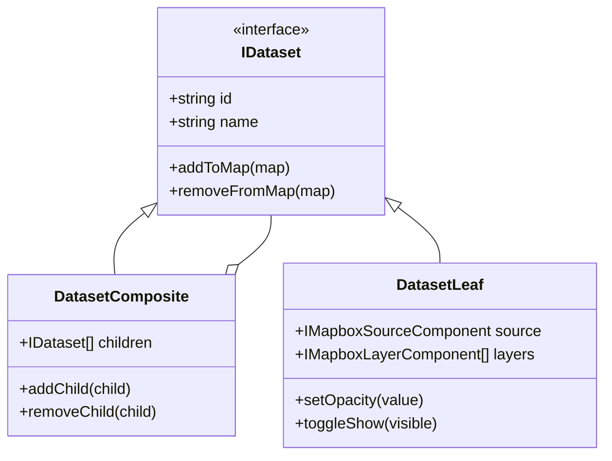

# Các khái niệm cốt lõi (Core Concepts)

Để sử dụng thành thạo và mở rộng thư viện `@hungpvq/map-*`, bạn cần nắm vững các khái niệm căn bản dưới đây.

---

## 1. Map Instance & `mapId`

### Khái niệm
Trong hệ thống, một đối tượng bản đồ WebGL được biểu diễn bằng interface `MapSimple` (tương thích hoàn toàn với `maplibregl.Map`). Mỗi bản đồ bắt buộc phải có một chuỗi định danh duy nhất gọi là `mapId`.

### Cơ chế truy xuất Map Instance
Thay vì phải truyền instance của bản đồ qua prop drilling qua hàng chục cấp component, bạn có thể lấy instance ở bất cứ đâu trong mã nguồn:

```ts
import { getMap, subscribeMapReady } from '@hungpvq/map-core';

// 1. Lấy ngay instance nếu bản đồ đã khởi tạo xong
const map = getMap('my-map-id');

// 2. Hoặc đăng ký callback lắng nghe khi bản đồ sẵn sàng
const unsubscribe = subscribeMapReady('my-map-id', (map) => {
  console.log('Bản đồ sẵn sàng:', map.getCenter());
});
```

---

## 2. Mô hình Dataset (Cây dữ liệu không gian)

Khác với MapLibre thuần vốn quản lý layer phẳng (flat list), `@hungpvq/map-dataset` tổ chức dữ liệu theo **Mô hình Cây phân cấp (Composite Pattern)**:



* **`DatasetComposite` (Nhóm dữ liệu)**: Chứa danh sách các dataset con, cho phép bật/tắt toàn bộ một nhóm lớp (ví dụ: nhóm "Giao thông", nhóm "Quy hoạch").
* **`DatasetLeaf` (Lớp dữ liệu lá)**: Chứa nguồn dữ liệu (`Source`: GeoJSON, Vector Tile, Raster) và một hoặc nhiều lớp hiển thị (`Layers`: Fill, Line, Symbol).
* **Tính năng tự động**: Khi gọi `setOpacity(0.5)` trên một Dataset, toàn bộ các layer con (bất kể là fill, line hay symbol) sẽ tự động được điều chỉnh độ mờ đồng bộ.

---

## 3. Hệ thống Registry (`UniversalRegistry`)

### Khái niệm
`UniversalRegistry` là một kho chứa các thành phần mở rộng dạng singleton toàn cục. Nó giải quyết bài toán: *Làm thế nào để module ngoài có thể bổ sung một nút bấm mới hoặc một menu mới vào giao diện bản đồ mà không cần sửa code giao diện gốc?*

### Cấu trúc Namespace
Registry phân loại các extension theo các namespace chuẩn (`REGISTRY_NAMESPACES`):
* `control`: Danh sách các nút bấm / panel điều khiển trên bản đồ.
* `menu`: Các hành động trong menu ngữ cảnh của Layer (xóa, xem thuộc tính, đổi màu, zoom to layer).
* `format`: Bộ chuyển đổi dữ liệu (Shapefile parser, KML parser, CSV parser...).

```ts
import { UniversalRegistry, buildMapControlHandle } from '@hungpvq/map-core';

// Đăng ký một nút bấm tùy biến vào Registry
const myControl = buildMapControlHandle({
  id: 'my-custom-tool',
  title: 'Công cụ của tôi',
  icon: 'mdi-wrench',
  action: (map) => {
    alert('Bấm nút thành công!');
  },
});

UniversalRegistry.register('control', 'my-custom-tool', myControl);
```

---

## 4. Scoped Stores (`MapStoreManager`)

Mỗi bản đồ có một bộ lưu trữ trạng thái riêng (Scoped Store), đảm bảo sự cô lập tuyệt đối:
* **`BaseMapStore`**: Lưu lớp nền hiện tại (OSM, Google Satellite, Carto Dark, None).
* **`MapDatasetStore`**: Lưu cây danh sách các dataset đang hiển thị và trạng thái đóng/mở của các nhóm.
* **`MapDrawStore`**: Lưu trạng thái công cụ vẽ, tính năng đang được chọn để chỉnh sửa.
* **`MapEventStore`**: Quản lý các callback click/hover được đăng ký trên bản đồ.

---

## 5. Theme & Đa ngôn ngữ (i18n)

* **Theme**: Cung cấp 7 theme màu giao diện được kiểm thử độ tương phản kỹ lưỡng (`light`, `dark`, `vibrant`, `ocean`, `forest`, `sunset`, `slate`). Theme được áp dụng bằng class CSS trên thẻ `html` hoặc scope riêng vào container của map (`.map-container[data-map-id]`).
* **Locale**: Hỗ trợ nạp động bộ dịch ngôn ngữ. Khi đổi ngôn ngữ qua `bootstrapMapLanguage('vi')`, tất cả các tooltip, nhãn nút và thông báo lỗi sẽ tự động chuyển đổi mà không cần tải lại trang.
