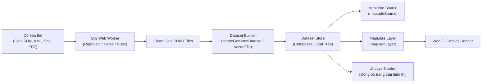
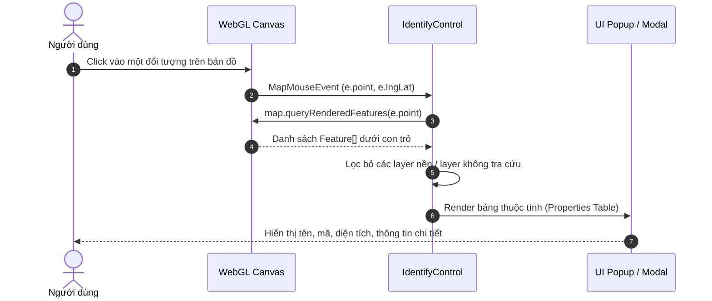

# Luồng dữ liệu trong hệ thống (Data Flow)

Tài liệu này mô tả cách thức dữ liệu di chuyển từ tệp nguồn (file GeoJSON, Shapefile, URL Vector Tiles) qua các tầng xử lý và kết thúc bằng việc hiển thị pixel lên màn hình WebGL.

---

## 1. Sơ đồ luồng dữ liệu (Data Pipeline)

---

## 2. Chi tiết từng bước trong luồng xử lý

### Bước 1: Nạp & Xử lý thô dữ liệu không gian
Khi người dùng tải lên một tệp bản đồ:
- Nếu file có dung lượng lớn (hoặc định dạng KML, Shapefile, GeoPackage nén dạng zip), hàm `loadGeojsonFileAsync` sẽ chuyển file qua **GIS Web Worker**.
- Worker chạy độc lập trên background thread, sử dụng `shpjs` hoặc `togeojson` để chuyển đổi sang GeoJSON chuẩn.
- Nếu dữ liệu sử dụng hệ tọa độ khác (ví dụ VN-2000 nội bộ), worker gọi `reprojectGeojsonAsync` (sử dụng thư viện `proj4`) để đưa tọa độ về hệ quy chuẩn WGS84 (EPSG:4326).
- Worker tính toán trước Bounding Box (`bboxFromGeojsonAsync`) và phân loại hình học (`Point`, `LineString`, `Polygon`).

---

### Bước 2: Khởi tạo đối tượng Dataset
Dữ liệu chuẩn sau khi xử lý được đưa vào hàm tạo dataset (ví dụ: `createGeoJsonDataset` hoặc `createVectorTileDataset`):
- Hệ thống tự động tạo một ID nguồn duy nhất (Source ID).
- Tự động sinh ra cấu hình Layer Style tương ứng với hình học:
  - Nếu là `Polygon`: Tạo layer `fill` (màu nền) và layer `line` (đường viền).
  - Nếu là `LineString`: Tạo layer `line` với độ dày mặc định.
  - Nếu là `Point`: Tạo layer `circle` hoặc `symbol`.
- Đóng gói toàn bộ vào một `DatasetLeaf`.

---

### Bước 3: Đưa dữ liệu lên MapLibre và đồng bộ UI
Khi gọi `addDataset(dataset)` thông qua hook `useMapDataset(mapId)`:
1. `dataset.addToMap(map)` được kích hoạt:
   - Gọi `map.addSource(sourceId, { type: 'geojson', data: ... })`.
   - Gọi `map.addLayer(...)` cho từng layer con đã định nghĩa.
2. Dataset được ghi nhận vào `MapDatasetStore` tương ứng với `mapId`:
   - Giao diện `<LayerControl>` tự động nhận diện có dataset mới và render một node tương ứng trên cây danh mục.
   - Các thuộc tính hiển thị (bật/tắt mắt xem, thanh trượt opacity) được ràng buộc 2 chiều (two-way binding) với MapLibre:
     - Khi người dùng kéo thanh Opacity: `setOpacity(val)` -> gọi `map.setPaintProperty(...)`.
     - Khi người dùng bấm tắt layer: `toggleShow(false)` -> gọi `map.setLayoutProperty(id, 'visibility', 'none')`.

---

## 3. Luồng dữ liệu khi tra cứu thông tin (Identify Feature Flow)

