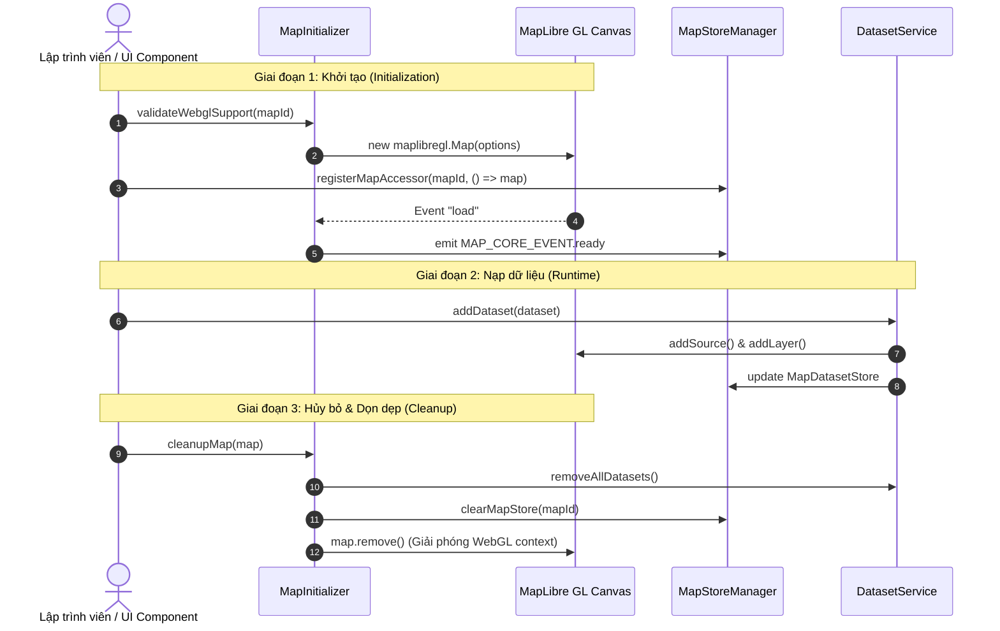

# Vòng đời bản đồ và tài nguyên (Lifecycle)

Quản lý vòng đời (Lifecycle) là yếu tố quyết định sự ổn định của ứng dụng Web GIS. Khác với DOM thông thường, MapLibre GL sử dụng WebGL Context, các bộ đệm GPU (GPU buffers) và Tile Workers. Nếu không quản lý vòng đời đúng cách, ứng dụng sẽ gặp lỗi rò rỉ bộ nhớ (Memory Leak) hoặc crash `WebGL Context Lost`.

---

## 1. Sơ đồ tuần tự vòng đời (Lifecycle Sequence)



---

## 2. Chi tiết các giai đoạn vòng đời

### Giai đoạn 1: Kiểm tra tương thích & Khởi tạo (Creation & Mount)

1. **Kiểm tra WebGL**: `MapInitializer.isWebglSupported()` kiểm tra trình duyệt có bật tăng tốc phần cứng hay không. Nếu không, ném ra lỗi `MapInitializationError`.
2. **Khởi tạo Canvas**: Tạo thẻ `<div class="map-container">`, thiết lập ResizeObserver để tự động gọi `map.resize()` khi kích thước thẻ chứa thay đổi (ví dụ: khi người dùng mở sidebar hoặc đổi kích thước cửa sổ).
3. **Đăng ký Accessor**: Gắn hàm getter của instance vào `MapPlatformRegistry` thông qua `registerMapAccessor(mapId, () => map)`.
4. **Sự kiện `load`**: Khi style cơ sở và glyph font nạp xong, MapLibre phát ra sự kiện `load`. Core phát tiếp sự kiện `MAP_CORE_EVENT.ready` để thông báo cho toàn bộ các control con bắt đầu render.

---

### Giai đoạn 2: Cập nhật & Tương tác (Update & Interaction)

* **Thêm Layer**: `dataset.addToMap(map)` thêm nguồn dữ liệu (`addSource`) trước, sau đó tuần tự thêm các lớp hiển thị (`addLayer`).
* **Thay đổi thuộc tính**: Khi gọi `dataset.setOpacity(val)` hoặc `dataset.toggleShow(bool)`, hệ thống gọi trực tiếp `map.setPaintProperty()` hoặc `map.setLayoutProperty()` mà không cần reload lại dữ liệu nguồn.
* **Thay đổi kích thước**: Khi container DOM thay đổi, phương thức `map.resize()` được gọi tự động (đã bọc qua debounce) để canvas không bị méo tỉ lệ.

---

### Giai đoạn 3: Hủy bỏ & Giải phóng tài nguyên (Destroy & Cleanup)

Khi component Vue hoặc React bị unmount (chuyển trang, đóng modal chứa bản đồ):

1. **Hủy lắng nghe sự kiện DOM**: Gỡ bỏ các event listener `click`, `mousemove`, `error` đã gắn trên canvas.
2. **Xóa Store**: Xóa bỏ scoped store tương ứng với `mapId` trong `MapStoreManager` để Garbage Collector dọn dẹp bộ nhớ.
3. **Giải phóng WebGL Context**: Gọi `map.remove()`. Phương thức này của MapLibre sẽ:
   - Dừng toàn bộ các animation loop (`requestAnimationFrame`).
   - Xóa bỏ WebGL Framebuffers, Textures và Shaders khỏi GPU.
   - Hủy bỏ các Tile Worker đang chạy nền.
   - Gỡ thẻ `<canvas>` khỏi cây DOM.

```ts
import { MapInitializer, getMap } from '@hungpvq/map-core';

function safelyDestroyMap(mapId: string) {
  const map = getMap(mapId);
  if (map) {
    MapInitializer.cleanupMap(map, {
      onDestroy: (m) => {
        console.log('Đang hủy bản đồ:', m);
      },
    });
  }
}
```
