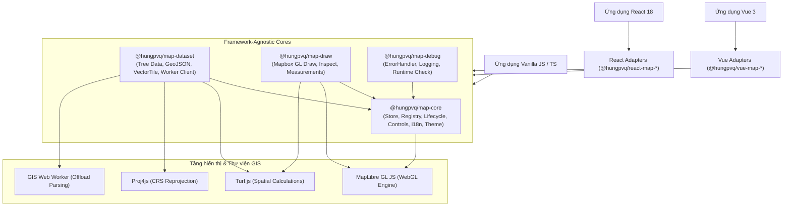

# Giới thiệu thư viện bản đồ (Introduction)

## 1. Mục đích và bài toán giải quyết

Trong phát triển ứng dụng Web GIS doanh nghiệp hiện đại, các lập trình viên thường đối mặt với các thách thức lớn:
1. **Sự gắn kết quá chặt (Tight Coupling) với Framework**: Mã nguồn điều khiển bản đồ MapLibre / Mapbox thường bị đan xen chặt chẽ vào vòng đời của Vue component hoặc React component, khiến việc tái sử dụng logic trong dự án khác hoặc chuyển đổi công nghệ trở nên tốn kém.
2. **Quản lý trạng thái phân tán**: Khi bản đồ có hàng chục layer, hàng trăm feature, nhiều control phụ trợ (đo khoảng cách, chuyển lớp nền, tìm kiếm, hiển thị bảng thuộc tính), việc đồng bộ trạng thái giữa WebGL canvas và giao diện DOM trở nên phức tạp.
3. **Hiệu năng xử lý dữ liệu GeoJSON lớn**: Việc phân tích, tính toán bounding box, chuyển đổi hệ tọa độ (Reprojection qua Proj4) ngay trên luồng chính (Main Thread) làm nghẽn UI (UI Freeze).
4. **Thiếu tính mở rộng (Extensibility)**: Không có cơ chế chuẩn mực để các module bên ngoài đăng ký thêm công cụ, nút bấm hoặc menu tương tác vào thanh công cụ bản đồ.

Hệ sinh thái thư viện **`@hungpvq/map-*`** được thiết kế để giải quyết triệt để các vấn đề trên.

---

## 2. Triết lý thiết kế (Design Philosophy)

Thư viện tuân theo các nguyên tắc cốt lõi:

* **Framework-Agnostic Core First**: Tất cả nghiệp vụ bản đồ, xử lý dữ liệu không gian, quản lý danh mục lớp nền, giao tiếp sự kiện và điều phối Web Worker được đóng gói hoàn toàn trong các gói thuần TypeScript (`@hungpvq/map-core`, `@hungpvq/map-dataset`, `@hungpvq/map-draw`). Không có bất kỳ dependency nào liên quan đến Vue hay React ở tầng lõi.
* **Adapter Pattern**: Các gói `@hungpvq/vue-map-*` và `@hungpvq/react-map-*` đóng vai trò là "vỏ bọc mỏng" (thin adapters). Chúng chỉ cung cấp reactive bindings (Vue `ref`/`computed` hoặc React `useContext`/`useState`) và UI components (render controls, modals, popups).
* **Universal Registry Pattern**: Sử dụng `UniversalRegistry` làm điểm đăng ký trung tâm cho toàn bộ các control, panel, format parser và menu ngữ cảnh. Cho phép kiến trúc plugin cắm rút linh hoạt mà không cần chỉnh sửa source code core.
* **Worker Offloading**: Tách các tác vụ nặng (parse Shapefile, KML, reprojection GeoJSON, tính toán BBox) sang Web Worker chuyên dụng (`@hungpvq/map-dataset/worker`), đảm bảo tốc độ phản hồi 60fps của bản đồ.
* **Strict Tree-Shaking & Stable API**: Không sử dụng `export *` bừa bãi. Các subpath được định nghĩa rõ ràng trong `package.json` (`@hungpvq/map-core/basemap`, `@hungpvq/map-core/theme`, `@hungpvq/map-dataset/geojson`, v.v.).

---

## 3. Kiến trúc tổng thể (Architecture Overview)

Sơ đồ quan hệ phân tầng giữa các module trong hệ sinh thái:

---

## 4. Bảng phân nhiệm các gói (Packages Overview)

### Nhóm 1: Core Libraries (Framework-Agnostic)

1. **`@hungpvq/map-core`**
   - Điểm vào chính: `MapInitializer` giúp kiểm tra WebGL, tạo cấu hình style mặc định, gán sự kiện.
   - Quản lý trạng thái: `MapStoreManager`, `getMap`, `registerMapAccessor`, `subscribeMapReady`.
   - Quản lý mở rộng: `UniversalRegistry`, `buildMapControlHandle`, `registerControlAutoButton`.
   - Hệ thống i18n: `bootstrapMapLanguage`, hỗ trợ đa ngôn ngữ (`en`, `vi`).
   - Hệ thống Theme: `applyMapThemeContrastClass`, hỗ trợ 7 theme màu chuẩn (`light`, `dark`, `ocean`, `forest`...).

2. **`@hungpvq/map-dataset`**
   - Cung cấp mô hình cây phân cấp dữ liệu (`DatasetComposite`, `DatasetLeaf`).
   - Hỗ trợ nguồn dữ liệu: `createGeoJsonDataset`, `createGeoJsonLayersDataset`, Vector Tiles (`PMTiles`, `MVT`).
   - Tương tác dữ liệu: Tra cứu thuộc tính `Identify`, quản lý bảng thuộc tính (`DataManagement`), cấu hình hiển thị style theo thuộc tính (`StyleControl`).

3. **`@hungpvq/map-draw`**
   - Đóng gói logic vẽ hình: `DrawService`, chế độ vẽ (`DrawingType`: Point, LineString, Polygon, Circle, Rectangle).
   - Kiểm tra thuộc tính tính năng (`InspectController`), render popup tùy biến.

4. **`@hungpvq/map-debug`**
   - Cung cấp `MapErrorHandler`, `installGlobalErrorCapture` giúp bắt toàn bộ sự kiện crash WebGL hoặc lỗi tải tile.

---

### Nhóm 2: Framework Adapters

1. **`@hungpvq/vue-map-core` & `@hungpvq/react-map-core`**
   - Cung cấp component `<Map>` đóng gói thẻ `
` canvas cùng resize observer.
   - Cung cấp bộ nút điều khiển UI có sẵn: `ZoomControl`, `HomeControl`, `GotoControl`, `BaseMapControl`, `MeasurementControl`, `PrintControl`, `ThemeControl`, `LanguageControl`, `FullScreenControl`.
   - Cung cấp hooks / composables: `useMap(mapId)`, `useMapState()`, `useMapInstance()`.

2. **`@hungpvq/vue-map-dataset` & `@hungpvq/react-map-dataset`**
   - Cung cấp `<LayerControl>` (cây danh mục lớp bản đồ có kéo thả sắp xếp layer).
   - Cung cấp `<AttributeTable>` (bảng hiển thị thuộc tính phân trang, lọc dữ liệu).
   - Cung cấp `<IdentifyControl>` (hiển thị popup kết quả bấm chọn đối tượng trên bản đồ).

3. **`@hungpvq/vue-map` & `@hungpvq/react-map` (Meta Packages)**
   - Đóng gói toàn bộ các package trên thành một gói duy nhất, giúp việc cấu hình `package.json` cực kỳ gọn gàng.
