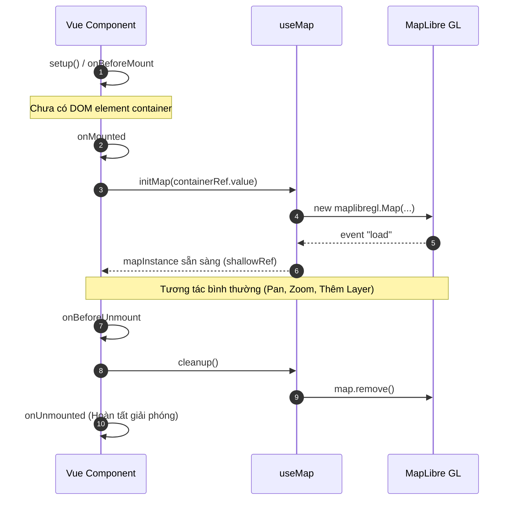

# Đồng bộ vòng đời với Framework (Framework Lifecycle)

Tài liệu này phân tích chi tiết cách đồng bộ vòng đời của MapLibre GL Canvas với vòng đời của Vue 3 Component và React 18 Component.

---

## 1. Bản chất sự khác biệt giữa WebGL Canvas và Virtual DOM

| Tiêu chí | Virtual DOM (Vue / React) | MapLibre WebGL Canvas |
| :--- | :--- | :--- |
| **Mô hình render** | Khai báo (Declarative), so sánh diff và patch DOM | Lệnh tuần tự (Imperative), vẽ từng frame lên GPU buffer |
| **Tần số cập nhật** | Khi state / props thay đổi | 60 fps liên tục khi pan, zoom, rotate, flyTo |
| **Chi phí khởi tạo** | Rất nhẹ (vài microsecond) | Rất nặng (tạo WebGL context, biên dịch shaders, nạp glyphs) |
| **Giải phóng tài nguyên** | Thu gom rác (Garbage Collector) tự động | Bắt buộc giải phóng thủ công (`map.remove()`, hủy WebGL buffer) |

---

## 2. Vòng đời trong Vue 3 Component



### Triển khai chuẩn trong Vue:
```vue
<script setup lang="ts">
import { shallowRef, onMounted, onUnmounted } from 'vue';
import type { MapSimple } from '@hungpvq/map-core';
import { MapInitializer, registerMapAccessor } from '@hungpvq/map-core';

const mapContainer = shallowRef<HTMLDivElement | null>(null);
const mapInstance = shallowRef<MapSimple | null>(null);
let cleanupEvents: (() => void) | null = null;

onMounted(() => {
  if (!mapContainer.value) return;

  const map = new (window as any).maplibregl.Map({
    container: mapContainer.value,
    style: MapInitializer.createMapStyle(),
    center: [105.85, 21.03],
    zoom: 12,
  });

  cleanupEvents = MapInitializer.setupMapEvents(map, {
    onLoad: (m) => {
      mapInstance.value = m;
      registerMapAccessor('my-vue-map', () => m);
    },
  });
});

onUnmounted(() => {
  cleanupEvents?.();
  if (mapInstance.value) {
    MapInitializer.cleanupMap(mapInstance.value);
    mapInstance.value = null;
  }
});
</script>
```

---

## 3. Vòng đời trong React 18 Component

### Triển khai chuẩn với React Hooks:
```tsx
import React, { useEffect, useRef } from 'react';
import type { MapSimple } from '@hungpvq/map-core';
import { MapInitializer, registerMapAccessor } from '@hungpvq/map-core';

export const SafeReactMap: React.FC<{ mapId: string }> = ({ mapId }) => {
  const containerRef = useRef<HTMLDivElement>(null);
  const mapRef = useRef<MapSimple | null>(null);

  useEffect(() => {
    let isDisposed = false;
    if (!containerRef.current) return;

    // Khởi tạo map
    const map = new (window as any).maplibregl.Map({
      container: containerRef.current,
      style: MapInitializer.createMapStyle(),
      center: [106.7, 10.8],
      zoom: 12,
    });

    const cleanupEvents = MapInitializer.setupMapEvents(map, {
      onLoad: (m) => {
        if (isDisposed) {
          m.remove();
          return;
        }
        mapRef.current = m;
        registerMapAccessor(mapId, () => m);
      },
    });

    return () => {
      isDisposed = true;
      cleanupEvents();
      if (mapRef.current) {
        MapInitializer.cleanupMap(mapRef.current);
        mapRef.current = null;
      } else {
        map.remove();
      }
    };
  }, [mapId]);

  return <div ref={containerRef} style={{ width: '100%', height: '100%' }} />;
};
```
