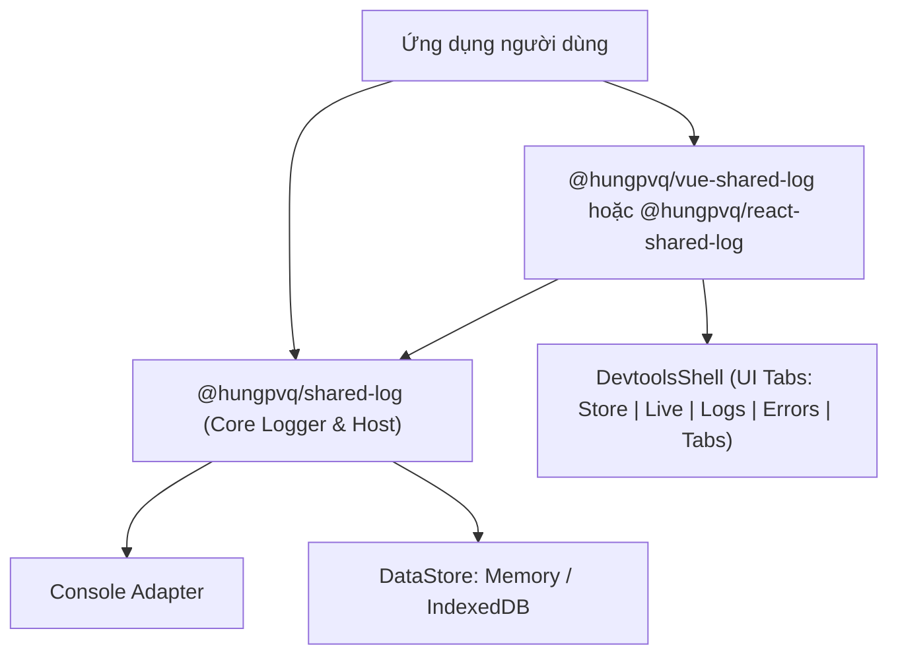

# Shared Log (`@hungpvq/*shared-log`)

Hệ sinh thái ghi log có cấu trúc (Structured Logging), theo dõi luồng thực thi thời gian thực (Live Tracing) và bộ công cụ Devtools Shell đa nền tảng (Vanilla JS/TS, Vue 3, React 18).

---

## 1. Tổng quan Kiến trúc (Architecture)

Hệ thống `@hungpvq/shared-log` được chia tách làm 3 package theo domain:

| Package | Nền tảng | Chức năng chính |
| :--- | :--- | :--- |
| **`@hungpvq/shared-log`** (`core`) | Framework-agnostic (Vanilla JS/TS) | Structured Logger, Ambient Zone Context (`ZoneContextStorage`), Persistence DataStores (Memory, IndexedDB), Live Tracing, Debug Host protocol |
| **`@hungpvq/vue-shared-log`** (`vue`) | Vue 3 | `DevtoolsShell`, `useLiveHookDebug`, các tab mặc định (Store, Live, Logs, Errors, Tabs), CSS |
| **`@hungpvq/react-shared-log`** (`react`) | React 18 | `DevtoolsShell`, `Devtools`, `useLiveHookDebug`, `LiveHookScope`, các tab mặc định, CSS |



---

## 2. Các tính năng nổi bật

1. **Structured Logging với Envelope chuẩn hóa**:
   Mọi bản ghi (Log hoặc Live trace) đều tuân theo interface `DebugRecord`:
   ```ts
   interface DebugRecord {
     id: string;
     header: {
       time: number;
       level: 'debug' | 'info' | 'warn' | 'error';
       namespace: string;
       kind?: 'log' | 'live';
       fn?: string;
       span?: string;
       actionId?: string;
     };
     data: {
       args?: any[];
       extra?: Record<string, any>;
     };
   }
   ```
2. **Bắt buộc Context cho mọi dòng log**:
   Mỗi logger call khuyến khích hoặc bắt buộc `.with({ fn, span })` để dễ dàng trace ngược stack gọi và trace nguồn gốc.
3. **Lưu trữ linh hoạt (LogDataStore)**:
   - `NoopLogDataStore`: Không lưu trữ (mặc định cho Console).
   - `MemoryLogDataStore`: Lưu trữ in-memory dạng ring buffer có giới hạn dung lượng (mặc định 10.000 bản ghi).
   - `IndexedDBLogDataStore`: Lưu trữ bền vững trên trình duyệt qua IndexedDB, hỗ trợ index tìm kiếm theo `actionId`, `namespace` và lọc kết quả.
4. **Devtools Shell & Giao thức Pin-first**:
   - Cho phép các thư viện khác (như `draggable`, `map-core`, `map-dataset`) hoặc ứng dụng tự đăng ký tab chẩn đoán vào `window.__hungpvqDebug` mà **không cần trực tiếp cài đặt hay phụ thuộc vào shared-log**.
   - Hỗ trợ bật/tắt động các tab thông qua API Tab Toggling.

---

## 3. Cài đặt nhanh (Quick Start)

### Cài đặt qua npm:

::: code-group
```bash [Core (Vanilla)]
npm install @hungpvq/shared-log
```

```bash [Vue 3]
npm install @hungpvq/shared-log @hungpvq/vue-shared-log
```

```bash [React 18]
npm install @hungpvq/shared-log @hungpvq/react-shared-log
```
:::

### Khởi tạo cơ bản:

```ts
import { installDebug, loggerFactory } from '@hungpvq/shared-log';

// 1. Kích hoạt hệ thống debug (mặc định lưu IndexedDB cho devtools)
installDebug();

// 2. Tạo logger theo namespace
const logger = loggerFactory.getLogger('auth-service');

// 3. Ghi log với ngữ cảnh rõ ràng
logger.with({ fn: 'loginUser', span: 'auth:attempt' }).info('User attempt login', {
  userId: 'usr_123',
});
```

---

## 4. Mục lục Tài liệu

- [Hướng dẫn Logger & Storage](./logger.md) — Sử dụng Logger, Zones Context, DataStores và Adapter.
- [Live Hook Tracing](./live-hook.md) — Theo dõi action lifecycle, `useLiveHookDebug` trên Vue & React.
- [Devtools Shell & Custom Tabs](./devtools.md) — Tích hợp giao diện Devtools, quản lý tab và giao thức pin-first.
- [Ví dụ thực tế (Examples)](./examples.md) — Mã nguồn mẫu hoàn chỉnh cho Vanilla, Vue 3, React 18 và custom tabs.
- [Stable API Allowlist](./stable-api.md) — Danh sách exports ổn định và cam kết SemVer.
